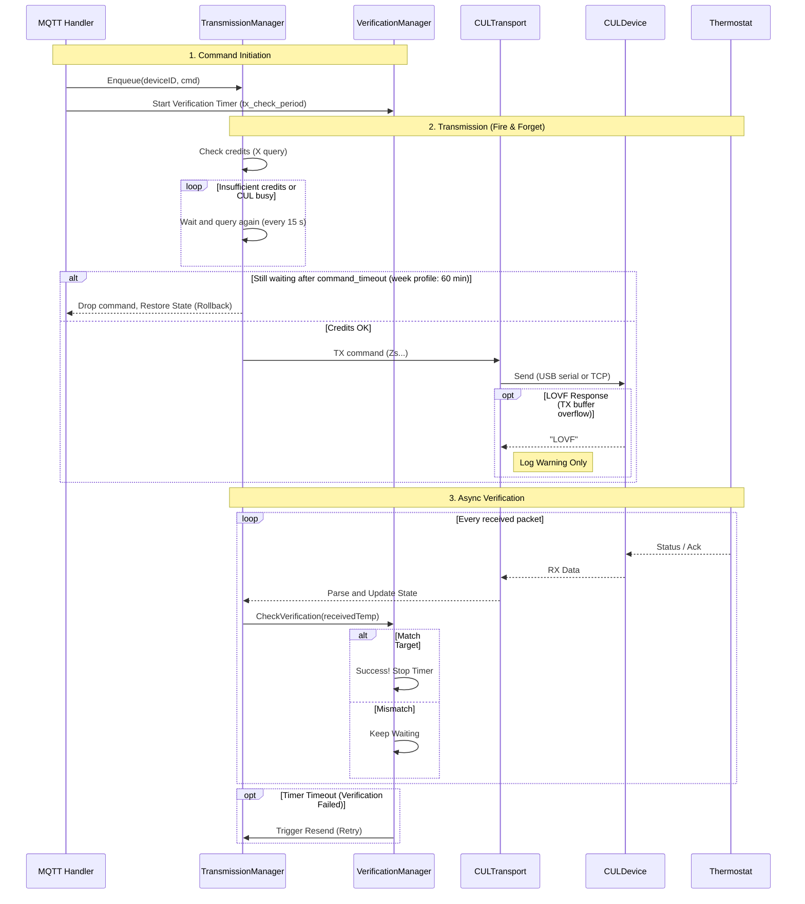

# Details of MAX! to MQTT Bridge for Home Assistant

## Migrating from the MAX! Cube integration

The bridge offers what Home Assistant's MAX! Cube integration offered: climate entity with HVAC modes `auto`/`heat`/`off`, presets `comfort`/`eco`/`Window Open`/`On`/`boost`/`none` with the same behavior, the same climate attributes (`valve_position`, `programme`, `comfort_temp`, `eco_temp`, `boost_duration`, …), battery and RF error ("link error") binary sensors, a valve position sensor, shutter contacts and a duty cycle sensor.

1. **Write down the Cube's values** before you remove the integration: the attributes of each climate entity (Developer tools → States) contain `comfort_temp`, `eco_temp`, `window_open_temp`, `window_open_duration`, `temp_offset`, `boost_value`, `boost_duration`, `decalc_day`, `decalc_time`, `max_valve`, `valve_offset` and `programme`.
2. Set `gateway_id` to the Cube's RF address, switch the Cube off, start the bridge (see the README).
3. **Import** the values per device (nothing is sent to the device). Convert two values: the Cube shows `window_open_duration` in 5-minute steps (`6` = 30 minutes) and `decalc_day` as a number (`0` = `Sat`, `1` = `Sun`, …, `6` = `Fri`). `max_temp`/`min_temp` are not shown by the Cube integration; the factory values are `30.5`/`4.5`.

   ```yaml
   # Home Assistant action, once per device
   action: mqtt.publish
   data:
     topic: max/0A1B2C/config/import
     payload: >-
       {"comfort_temp": 16, "eco_temp": 12, "max_temp": 30.5, "min_temp": 4.5, "measurement_offset": 0,
        "window_open_temp": 7, "window_open_duration": 30,
        "boost_duration": 15, "boost_valve_position": 100, "decalc_day": "Sat", "decalc_hour": 9,
        "max_valve_setting": 100, "valve_offset": 0}
   ```

   The week program: publish the Cube's `programme` attribute unchanged to `max/<id>/programme/import`.
4. **Service `maxcube.set_programme`** becomes `mqtt.publish` to `max/<id>/programme/set` with the same data as JSON: `{"day": "monday", "slots": [{"temp": 18, "until": "07:00"}, …]}`. Unchanged days are not sent again, as with the Cube.
5. **Entity IDs:** the bridge's entities get new IDs (e.g. `climate.max_0a1b2c_…`). Rename them in Home Assistant to the old IDs of the Cube integration (after removing it), so automations and dashboards keep working.

Not available: the Cube's "free memory slots" sensor (no such thing on a CUL).

## CUL connection (USB or TCP)

The bridge talks to a CUL-FW compatible radio interface. From v1.2.0, `serial_port` selects the transport:

| Mode | `serial_port` | Notes |
|------|---------------|--------|
| USB serial | `/dev/ttyUSB0`, `/dev/serial/by-id/...`, … | Uses `baud_rate` (default `38400`) |
| Network | `tcp://host:port` | Raw TCP; `baud_rate` ignored |
| Network (alias) | `telnet://host:port` | Same as TCP (maxcul-compatible URL) |

After connect, the protocol is identical for both transports (`V`, `Zr`, `Za<gateway_id>`, credit `X`, `Z…` telegrams). On disconnect, the bridge reconnects automatically.

### Auto-Ack (`Za`)

On every (re)connect the bridge sends `Za<gateway_id>` to the CUL. culfw then acknowledges every packet addressed to the gateway by itself (same as FHEM `CUL_MAX`). Without this, paired devices (radiator thermostats, wall thermostats, shutter contacts) do not get an Ack for their state messages: they repeat them, which costs battery and duty cycle, and set their `rferror` bit. Acks with the gateway as source are the CUL's own auto-Acks and are ignored by the bridge.

## Time Synchronization

The bridge automatically syncs time (Type `0x03`) with devices:
-   On startup: broadcasts to all devices (after some delay)
-   After pairing: sends directly to the newly paired device
-   On device request: responds when a device sends a TimeInformation request
-   Every 1 hour: broadcasts to all devices to keep clocks accurate

## Duty Cycle and Buffer Management

The bridge adheres to 868MHz 1% transmission limits using CUL's credit system.
-   Before each TX: queries CUL credits and queue status (`X` command).
-   Only transmits if queue is below and credits are above configurable thresholds.
-   Commands are queued internally and processed sequentially. If a command cannot be sent (insufficient credits or CUL busy), it is immediately discarded without retry. The previous MQTT state is restored to sync Home Assistant with the actual device state.

## Detailed Queue Behavior

1. Command is dequeued from the channel
2. Credits are checked via `X` command
3. If credits < threshold or CUL queue busy → command is immediately discarded and state restored
4. Command is sent to the CUL (USB serial or TCP)
5. LOVF check: If CUL returns "LOVF", log warning only and recommend to increase the credit threshold
6. Done! The next RX from the device will confirm/correct state if needed

Commands are "fire-and-forget" after passing the credit check. The system is self-correcting—any state mismatch (e.g., from a lost TX packet) is automatically fixed when the device next transmits its current state.

## Set Temperature Verification

To improve reliability for "Set Temperature" commands (Type `0x40`), a verification mechanism is implemented:

1.  **Tracking**: When a set temperature command is sent, the bridge starts tracking the expected value for that device.
2.  **Verification**: Every incoming status packet (`0x70`, `0x40`, `0x02`, etc.) from the device is checked:
    -   If the reported temperature matches the expected value, the verification is marked successful.
    -   If the reported temperature *differs*, the system continues waiting.
3.  **Timeout & Retry**: If no matching confirmation is received within the configured `TX_CHECK_PERIOD` (default 1 minute), the command is considered failed (e.g., lost packet) and is automatically resent once.
4.  **Priority**: If a user manually changes the temperature on the device immediately after an MQTT command, the verification logic sees a mismatch. It will wait for the `TX_CHECK_PERIOD` to expire and then automatically resend the MQTT command to enforce the requested value (as the verification target is always the last sent command).

## Waiting for duty cycle credits

A command that finds too few credits (`duty_cycle_min_credits`) or a busy CUL queue (`max_cul_queue`) is not dropped at once:
the bridge queries the credits again every 15 s and sends it as soon as there are enough.
Only after `command_timeout` (default `1m`) the command is dropped and the old state is restored in Home Assistant.
The CUL refills about one credit per second; a message with wakeup preamble costs about 100.

Week profile messages are a bulk transfer: they may wait up to 60 minutes, and setpoint, mode or config commands sent in the meantime go first.

## TX Flow Diagram



## Protocol Details

This bridge implements the following filter of message types.

**Disclaimer**: The MAX! protocol is not public and the following information is based on reverse engineering done by AI. So I can't really say for sure if this is correct.

### Supported Message Types

-   **Wall Thermostat State (`0x70`)**:
    -   **Description**: The primary status message from Wall Mounted Thermostats.
    -   **Why**: Contains the authoritative Mode, Valid Setpoint, and Battery status for the room.
-   **Wall Thermostat Control (`0x42` / `0x40`)**:
    -   **Type 0x42**: Sent when adjustments are made directly on the device (e.g., turning the wheel).
    -   **Type 0x40**: Set Temperature/Mode packet. When received from a device, it indicates a manual change (button press/wheel turn).
    -   **Why**: Accepted by the bridge to provide immediate feedback on manual changes in Home Assistant.
-   **Acknowledgements (`0x02`)**:
    -   **Description**: Acks with a payload length $\ge$ 4 bytes.
    -   **Why**: Provides immediate confirmation of Mode and Setpoint changes. Packets with length $\ge$ 6 bytes also contain the Actual Temperature.
-   **Radiator Thermostat State (`0x60`)**:
    -   **Description**: Periodic status updates from radiator valves.
    -   **Why**: Accepted to monitor Battery State and confirm receipt of commands sent directly to valves.
    -   **Valve position**: Byte 1 of the payload is the valve opening in % (FHEM `valveposition`). It is published retained on `max/<id>/valve` and exposed as sensor *Valve Position*. Acks (`0x02`) from a radiator thermostat carry the same layout and update the value too; for wall thermostats this byte is the display flag and is ignored. A device counts as radiator thermostat once a `0x60` was received since the bridge started.
    -   **Note**: Radiator thermostats only send their state when something changes (valve moves, setpoint changes), so the value can stay unchanged for a long time.
-   **RF error bit**: Bit 6 of the status byte (`0x02`/`0x60`/`0x70`) is published as `rf_error` in `max/<id>/state` and exposed as diagnostic binary sensor *RF Error*.

-   **Shutter Contact State (`0x30`)**:
    -   **Description**: Sent by window/door contacts on every change. One payload byte: bits 0-1 ≠ 0 → open, bit 6 RF error, bit 7 battery low (FHEM `10_MAX.pm`).
    -   **Why**: Published as `{"window": "open|closed", "battery": "ok|low", "rf_error": false}` retained on `max/<id>/state`; discovery creates the binary sensors *Window*, *Battery* and *RF Error* (no climate/config entities).
    -   **Repeats**: The contact sends the same message (same counter) to the gateway and to every linked thermostat; repeats within 10 s are processed once.
    -   **Pairing**: As for thermostats (`max/bridge/pair`). Link the contact with the thermostat(s) in both directions (see README, partner type 4), so the thermostat applies its window-open temperature.

### Ignored Message Types

-   **Short Acknowledgements (`0x02`)**:
    -   **Description**: Acks with payload length &lt; 4 bytes (no full thermostat state).
    -   **Reason**: Still used to **confirm pending config TX** (Ack tracker); climate state is not updated from short Acks.

## Device Configuration

After pairing, devices expose Home Assistant MQTT discovery entities with `entity_category: config`. Values are retained on `max/<id>/config`.

### Push / Ack confirmation (no polling)

CUL delivers device Acks as soon as the thermostat answers. Flow:

1. HA writes a config Number/Select (or climate preset)
2. Bridge sends the radio command and optimistically updates retained MQTT state
3. Device Ack (`0x02`) or status push confirms; bridge re-publishes authoritative state
4. If no Ack within ~30s, previous values are restored

There is no “query all config” over CUL: MAX! devices cannot be asked for their settings.

### Unknown config values (import first)

The temperature group (`0x11`: comfort, eco, max, min, measurement offset, window open temperature and duration) and the valve group (`0x12`: boost duration and valve position, decalcification day and hour, max valve setting, valve offset) are always sent complete.
As long as the bridge does not know a device's real values, the config entities show *unknown*, and changing a single value is refused (error in the log) – it would overwrite the device's other settings with defaults.
The presets eco and comfort are refused for the same reason.

Tell the bridge the real values once, e.g. from your MAX! Cube or FHEM, with a complete group (or both):

```bash
# store only, nothing is sent to the device
mosquitto_pub -t "max/0A1B2C/config/import" -m '{"comfort_temp": 21, "eco_temp": 17, "max_temp": 30.5, "min_temp": 4.5, "measurement_offset": 0, "window_open_temp": 12, "window_open_duration": 15, "boost_duration": 5, "boost_valve_position": 80, "decalc_day": "Sat", "decalc_hour": 12, "max_valve_setting": 100, "valve_offset": 0}'
```

`max/<id>/config/set` takes the same JSON, stores it and sends it to the device (for new devices, or to reset all values at once).
`window_open_duration` is in minutes (steps of 5), `decalc_day` is `Sat` … `Fri`.

> **Important**: Don't change many config values in a short time — duty-cycle credits will block TX.

### Climate presets

Presets on the climate entity, as in the MAX! Cube integration (HVAC modes remain `auto` / `heat` / `off`):

| Preset | Sends | Shown when |
|---|---|---|
| `comfort`, `eco`, `Window Open` | that temperature from the device config, mode kept (auto: until the next switch point; from boost/vacation: manual) | the setpoint equals it |
| `On` | 30.5 °C (valve fully open), mode kept | the setpoint is 30.5 °C |
| `boost` | boost mode (`0x40` with temperature 0) | the device is in boost |
| `none` | in boost: back to the mode and setpoint from before the boost; otherwise auto (week program) | none of the above |

`comfort`, `eco` and `Window Open` need known config values ([import](#unknown-config-values-import-first)); `Window Open` is also what a linked shutter contact sets when the window opens.

### Vacation mode

Holds a temperature until a date/time; afterwards the thermostat returns to auto (week program) by itself, without the bridge.

| Topic | Payload | Effect |
|-------|---------|--------|
| `max/<id>/vacation/set` | `{"temperature": 12, "until": "2026-11-02 18:00"}` | Vacation mode, 12 °C until 2 Nov 2026 18:00 |
| `max/<id>/vacation/set` | `{"until": "2026-11-02 18:00"}` | Same with the device's eco temperature (only when it is known, see [Unknown config values](#unknown-config-values-import-first)) |
| `max/<id>/vacation/set` | `off` | End early: auto with the week program temperature |

- `until` is local time as `YYYY-MM-DD HH:MM` (also `T` as separator and seconds, as Home Assistant `input_datetime` states). The device only knows full and half hours: minutes are rounded down to `:00`/`:30`. It must be in the future.
- `temperature`: 4.5–30.5 °C, step 0.5.
- The device needs the correct time (time sync, see above).
- In vacation mode `max/<id>/state` contains `"mode": "vacation"` and `"until": "2026-11-02 18:00"`; the climate entity shows HVAC mode `off` and the "Vacation Until" sensor the end date. A new setpoint, preset or HVAC mode from Home Assistant also ends vacation mode.

Example Home Assistant script action:

```yaml
action: mqtt.publish
data:
  topic: max/0A1B2C/vacation/set
  payload: '{"temperature": 12, "until": "{{ states(''input_datetime.vacation_end'') }}"}'
```

### ConfigTemperatures (`0x11`)

| Entity | Range | Notes |
|--------|-------|--------|
| Eco / Comfort Temperature | 4.5–30.5 °C | Stored preset values |
| Min / Max Temperature | 4.5–30.5 °C | Device limits |
| Measurement Offset | −3.5–+3.5 °C | Calibration |
| Window Open Temperature | 4.5–30.5 °C | 4.5 = Off (disable) |
| Window Open Duration | 0–60 min (step 5) | Drop detection window |

### ConfigValve (`0x12`, radiator thermostats)

| Entity | Notes |
|--------|--------|
| Boost Duration | 0, 5, 10, 15, 20, 25, 30, 60 min |
| Boost Valve Position | 0–100% (step 5) |
| Decalcification Day / Hour | Sat–Fri, 0–23 |
| Max Valve Setting / Valve Offset | 0–100% |

### Other

- **Display Mode** (wall): Setpoint vs Actual (`0x82`)
- **Group ID**: 0–255 (`0x22` / remove at 0)
- **Disassociate Partner**: text `PARTNER` or `PARTNER:type` (`0x21`)
- **Factory Reset**: button (`0xF0`) — destructive
- **Week Profile Monday … Sunday**: one text entity per day in FHEM syntax, see [Week profile](#week-profile-0x10)
- **Bridge Pairing**: button on the bridge device → `max/bridge/pair`

### Week profile (`0x10`)

Each day has up to 13 control points "temperature until time"; the last one ends at 24:00.
MAX! devices cannot be asked for their week profile, so the bridge shows the last one it sent or imported (unknown until then).

| Topic | Payload | Effect |
|---|---|---|
| `max/<id>/week_profile/<day>/set` | `17,06:00,21,22:00,17` (FHEM syntax: temperature, until, …, last temperature until 24:00) | send one day |
| `max/<id>/programme/set` | `{"day":"monday","slots":[{"temp":17,"until":"06:00"},{"temp":21,"until":"22:00"},{"temp":17,"until":"24:00"}]}` (like the MAX! Cube integration's `set_programme` service), or a whole week `{"monday":[…],"tuesday":[…]}` | send |
| `max/<id>/programme/import` | whole or part of a week in the same format | store only, nothing is sent (e.g. the profile your MAX! Cube showed) |
| `max/<id>/week_profile/set` | `{"Mon":{"time":["06:00","22:00","24:00"],"temp":[17,21,17]}}` (older format, `time` = until) | send |

`<day>` is `monday` … `sunday`. Days that did not change are not sent again.
A day with up to 7 control points takes one radio message, more take two. Messages wait for duty cycle credits if needed.
State: `max/<id>/week_profile/<day>` (FHEM syntax, shown by the text entities) and `max/<id>/programme` (whole week, MAX! Cube format).

### After a restart

The bridge keeps its device data in `/data/devices.json` (the add-on's persistent folder): last state (mode, setpoint, actual temperature), valve position, room/group ID, device type, config values and whether they are known, and the week profile.
It is written at most every 30 s when something changed, and on shutdown. Standalone (Docker): set `DEVICE_DATA_FILE` to a persistent path.
Only a device the bridge has never heard of starts as `heat` (manual) until its first status message.

### Debug logging

Set `log_level: debug` in the add-on options (or `LOG_LEVEL=debug`). That enables:

- Raw CUL RX lines and credit reports
- Full MAX packet headers (`dst`, `group`, `flag`, `cnt`, raw hex)
- SetTemperature encoding (`mode_bits`, `payload_byte`, `gateway_id`, wake-up decision)
- TX packet field breakdown and pending Ack tracking

Keep `info` for normal operation; debug is verbose.

### SetTemperature / mode not applying

1. **`gateway_id` must match the address used when devices were paired** (FHEM `CUL_MAX` / previous cube). RX works regardless; TX is only accepted from the paired master. Check logs: `Queueing TX` shows the source embedded in `hex` (bytes after type `40`).
2. After RX, the bridge learns each device’s **room group ID** and sends SetTemperature with flag `0x04` when group ≠ 0.
3. Radiator valves sleep: the bridge sends **WakeUp** before SetTemperature if the device has been quiet. Prefer commanding after you see a `Parsed Packet` from that device.
4. Look for `CUL TX` / `TxMgr: TX dispatched`, then either `Short Ack applied pending setpoint` or `Parsed Packet` from the device. Verification failure with **no** Ack lines means the radio/master address did not reach the device.
5. Switch to `log_level: debug`, reproduce one setpoint change, and capture the `SetTemp encoding` / `TX packet fields` / `RX` lines.

`fakeSCaddr` / `fakeWTaddr` are FHEM-only CUL_MAX attributes (virtual shutter contact / wall thermostat). max2mqtt does not use them for SetTemperature.

## Add-on Configuration

### Watchdog and restart

There is no watchdog endpoint configured in the addon nor there is a healtcheck configured in Dockerfile. So, we only rely on the containers Exited state, which signals that the main process (PID 1) of the container has died. If you want to automatically restart the add-on in such case, then activate the Watchdog button on the Add-on information page.

### Finding your Serial Port

On Linux, it is recommended to use the persistent `by-id` path so the device remains found even after reboots or unplugging.

Run this command:
```bash
ls -l /dev/serial/by-id/
```

You should see something like:
`usb-busware.de_CUL868-if00 -> ../../ttyACM0`
Or for a Nano CUL:
`usb-SHK_NANO_CUL_868-if00-port0 -> ../../ttyUSB0`

Use the full path in your config:
`/dev/serial/by-id/usb-SHK_NANO_CUL_868-if00-port0`

### Network CUL (TCP)

If your CUL is reachable over the network (CUN/CUNO, ESP/ser2net bridge, etc.), set `serial_port` to a URL instead of a device path.

**Add-on options example:**

```yaml
serial_port: "tcp://192.168.1.50:2323"
baud_rate: 38400
mqtt_broker: "tcp://homeassistant.local:1883"
gateway_id: "123456"
log_level: "info"
```

**URL rules:**

- Prefer `tcp://host:port` (e.g. `tcp://192.168.1.50:2323`). Port is required.
- `telnet://host:port` works as an alias (same raw TCP dial; no Telnet IAC negotiation).
- Host may be an IP or DNS name reachable from the Home Assistant host / add-on network.
- `baud_rate` is ignored for network CULs; leave the default.
- Do **not** map USB devices under the add-on hardware settings when using TCP.

**Successful connect** appears in the log as:

```text
Opened CUL TCP connection addr=<host>:<port>
```

followed by init commands `V`, `Zr`, `Za<gateway_id>` and `X` (same as USB).

## Troubleshooting

### Cannot open CUL / reconnect loop

- **USB:** Confirm the device path exists inside the add-on (`/dev/serial/by-id/...`) and that the add-on has access to the stick.
- **TCP:** Confirm another host can open `host:port` (firewall, correct port — often `2323`). Check the log for `Failed to connect to CUL over TCP` or `Invalid CUL network URL`.
- The bridge retries every few seconds after a failed open or a dropped connection.

### LOVF Error

If you see a LOVF error in the logs, it means that the CUL stick is full and cannot accept any more commands. The bridge only logs a warning and does not restore any former state nor does it stop sending commands. This is an indicator to better increase the credit threshold configuration parameter "duty_cycle_min_credits". 

## Standalone Docker Deployment

```bash
# Build the image
docker build -t max2mqtt .

# USB CUL
docker run -d \
  --device=/dev/ttyACM0 \
  -e MQTT_BROKER=tcp://192.168.1.10:1883 \
  -e SERIAL_PORT=/dev/ttyACM0 \
  max2mqtt

# Network CUL (no --device needed)
docker run -d \
  -e MQTT_BROKER=tcp://192.168.1.10:1883 \
  -e SERIAL_PORT=tcp://192.168.1.50:2323 \
  max2mqtt
```
For a USB CUL, `--device /dev/ttyACM0` must match `SERIAL_PORT` so the container can access the host serial device.
For a network CUL, set `SERIAL_PORT=tcp://host:port` and omit `--device`.
Also see the configuration section in Readme for the full list of environment variables.

## Development

The project is written in Go. To build locally:

```bash
go mod download
go build -o max2mqtt .
```

### Cross-Compilation for Linux

If you are building on macOS/Windows for a Linux host (e.g., Raspberry Pi or Debian Server):

**For Standard Linux (AMD64/x86_64):**
```bash
CGO_ENABLED=0 GOOS=linux GOARCH=amd64 go build -ldflags="-w -s" -o max2mqtt-linux-amd64 .
```

**For Raspberry Pi 3/4/5 (64-bit ARM / aarch64):**
```bash
CGO_ENABLED=0 GOOS=linux GOARCH=arm64 go build -ldflags="-w -s" -o max2mqtt-linux-arm64 .
```

**For Older Raspberry Pi / 32-bit OS (ARMv7 / armv7l):**
```bash
CGO_ENABLED=0 GOOS=linux GOARCH=arm GOARM=7 go build -ldflags="-w -s" -o max2mqtt-linux-armv7 .
```

## Testing

The `test` directory contains configuration files and scripts to help verify the reliability of the bridge, specifically for thermostat operations within Home Assistant.

### Thermostat Setpoint Test

A comprehensive test script is provided to verify that "Set Temperature" commands are correctly applied to your thermostats over a longer period. This is useful for checking connection reliability and the bridge's verification logic.

The test setup consists of two parts:

#### 1. Input Helpers (`test/input_helpers.yaml`)

This file defines the necessary helpers to track the test state and statistics.
Add the contents of `test/input_helpers.yaml` to your Home Assistant `configuration.yaml` file:
*Note: You must restart Home Assistant after adding these helpers.*

#### 2. Test Script (`test/thermostat_test_script.yaml`)

This script runs the actual test logic. It performs the following actions:
-   Runs for a configurable duration (default: 1 hour).
-   In each cycle, it sets a random temperature (between 16°C and 25°C) for two configured thermostats.
-   Waits for a propagation delay (default: 120s) to allow the command to reach the device and the device to report back its new state.
-   Verifies if the reported temperature matches the setpoint.
-   Increments success/failure counters and sends notifications on failure or completion.

#### Setup Instructions

1.  Open `test/thermostat_test_script.yaml`.
2.  **Configure the variables** at the top of the file:
    -   `thermostat_1` and `thermostat_2`: Replace with your actual thermostat entity IDs (e.g., `climate.wall_thermostat_living_room`).
    -   `wait_seconds`: Adjust if you need more or less time for propagation.
3.  Copy the entire content into your Home Assistant `scripts.yaml` file (or append it if you already have scripts).
4.  Reload Scripts in Home Assistant (Developer Tools -> YAML -> Scripts).

#### Running the Test

trigger the script `script.thermostat_setpoint_test` via Developer Tools > Services or create a button in your dashboard.

#### Monitoring

-   You can watch the counters `counter.thermostat_test_success` and `counter.thermostat_test_failure` in real-time.
-   The `input_boolean.thermostat_test_running` will be `on` while the test is active.
-   You will receive a persistent notification in Home Assistant upon test completion or if a specific check fails.
